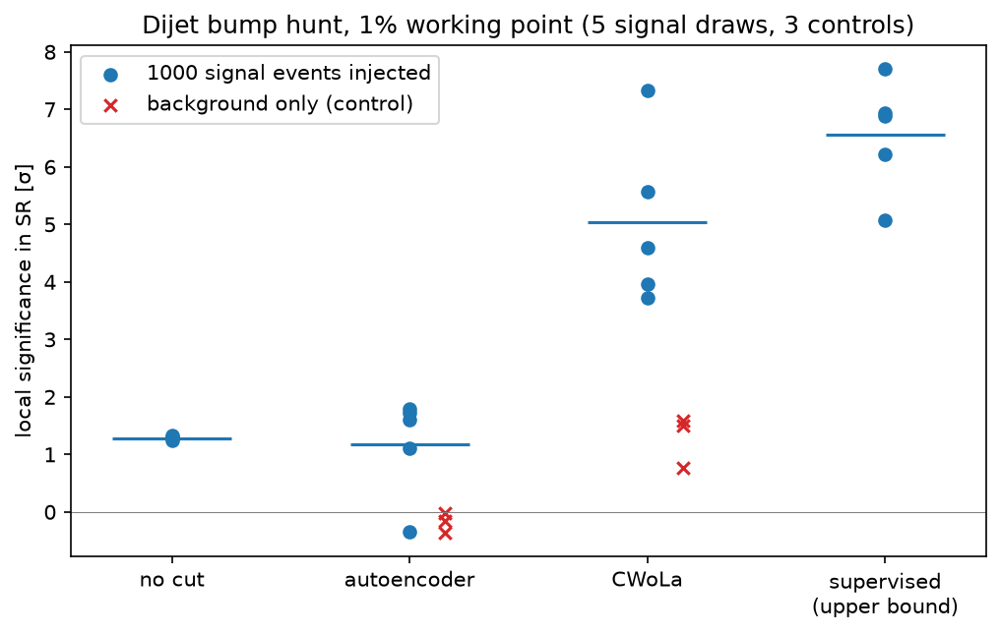

# CERN-Anomaly

A small, end-to-end study on public particle-physics data:
- rebuilding dimuon resonances from CMS 2011 open data;
- a C++ cross-check and ROOT file I/O;
- a label-free dijet anomaly search on the LHC Olympics 2020 R&D dataset.

Every number below comes from the scripts in `src/` and can be reproduced from the public data (see [DATA.md](DATA.md)). The full write-up, including what didn't work, is in [REPORT.md](REPORT.md).

## Results

| Part | Data | Result |
|---|---|---|
| A. Dimuon spectrum | CMS 2011, CERN Open Data record 545 (83,761 events) | Recovered the J/ψ, Υ and Z peaks. Found that in 4% of rows the released muon `px/py/pz` don't match `pt/η/φ`. J/ψ unbinned fit: 3.0940 ± 0.0009 GeV, 3σ below the PDG value; this reflects the simple model, not a measurement |
| B. C++ cross-check | same | A C++17 re-implementation agrees with Python to 5×10⁻¹⁰ GeV on every event |
| D. ROOT I/O | same | Events written to and read back from a ROOT RNTuple with uproot and awkward-array. float32 storage corrupts the mass of a few extreme-momentum events |
| C. Dijet anomaly search | LHC Olympics 2020 R&D, Zenodo 4536377 (1M background + 1,000 injected signal events) | Sideband bump hunt with a Poisson-likelihood dijet fit. Significance with a 1% selection: no cut 1.3σ, sideband autoencoder 1.2σ, CWoLa 5.0σ, supervised upper bound 6.6σ. On background-only data, CWoLa gives a **+1.3σ false excess** (mass sculpting) |

Signal labels are used only to score each method at the end, never for training or for choosing cuts.



## Reproduce

Follow [DATA.md](DATA.md) to download the two public datasets into `data/`, install the Python packages, and run the scripts in order. A run from a fresh clone reproduces every result in `results/` exactly. On a laptop CPU, Part C takes about 6 minutes.

## Layout

```
src/a1_dimuon_spectrum.py   Part A: invariant mass, data-quality check, J/psi fit
cpp/invmass.cpp             Part B: C++17 mass calculation
src/b_check_cpp.py          Part B: compile, run and compare with Python
src/d_root_io.py            Part D: ROOT RNTuple round trip with uproot
src/c_anomaly.py            Part C: features, bump hunt, sideband autoencoder
src/c_cwola.py              Part C: CWoLa with K-fold cross-fitting, supervised bound
src/c_summary.py            Part C: summary figure
src/c_dev_features.py       development-only feature comparison (uses labels)
results/                    raw outputs (JSON)
figures/                    plots
```

## Limitations

- The data is simulated (LHCO) or pre-selected (CMS), and there are no detector systematics.
- There is one signal model and one signal region, with no window scan and no look-elsewhere correction.
- The feature transforms were chosen on the labelled R&D data, so Part C is a development study, not a blind test.

See [REPORT.md](REPORT.md) for details.

## Data and licence

The code is released under the MIT licence (see [LICENSE](LICENSE)). The datasets are not included:
- CMS dimuon data: CERN Open Data record 545 (CC0).
- LHC Olympics 2020 R&D dataset: Zenodo record 4536377. Please cite G. Kasieczka et al., "The LHC Olympics 2020", arXiv:2101.08320.
